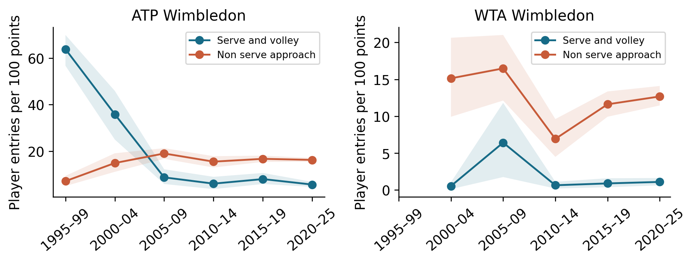
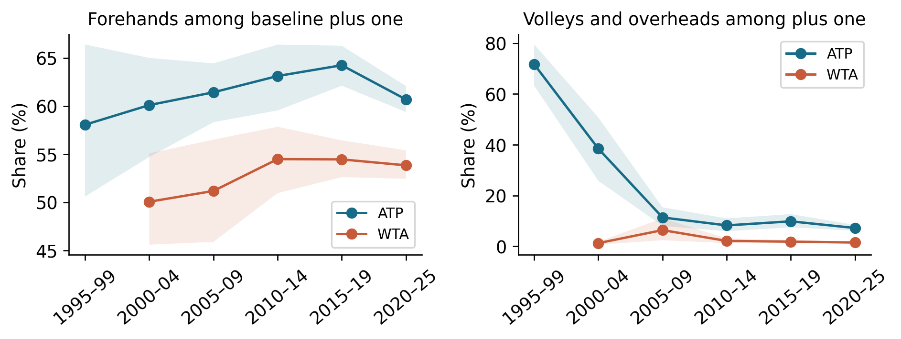
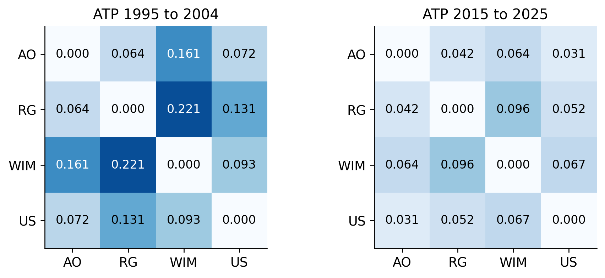
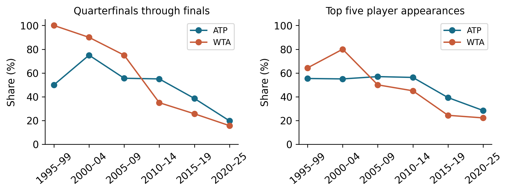

# Grand Slam tactics and rally convergence 1995–2025

In the charted men’s Wimbledon matches, serve-and-volley fell from 52.1 to 6.5 attempts per 100 match points, while approaches after the serve rose from 10.4 to 16.4. Wimbledon’s rally-length distribution also moved closer to the Australian Open and Roland Garros distributions. Even during 2020–2025, the same ATP players tended to play shorter service rallies at Wimbledon than at the other Slams in the same season.

## How net play changed at Wimbledon

Early refers to 1995–2004 and late to 2015–2025. Rates give each match equal weight and count player involvements per 100 match points. Both players can contribute in the same point. The 95% intervals resample matches.

| ATP Wimbledon measure | Early | Late | Change | 95% interval for change |
| --- | ---: | ---: | ---: | ---: |
| Serve-and-volley attempts | 52.1 | 6.5 | −45.6 | −52.5 to −38.6 |
| Non-serve net approaches | 10.4 | 16.4 | +6.0 | +3.5 to +8.4 |
| All net involvements | 65.8 | 28.5 | −37.3 | |
| Mean rally length in shots | 2.8 | 3.6 | +0.8 | |

*Shading shows pointwise 95% match-bootstrap intervals. Panels use different vertical scales. Periods with fewer than ten eligible matches for a measure are omitted.*

Explicit shot markers give a narrower view of when players came forward. In ATP Wimbledon, return approaches fell from 1.42 to 0.51 per 100 points, serve-plus-one approaches rose from 3.43 to 6.63, and approaches on shot four or later rose from 4.33 to 6.48. The later entries represented 52.3% of marked approaches early and 47.6% late, with a confidence interval for the change that crossed zero. These codes record when an approach occurred. Intent and opportunity quality are unobserved.

The server’s first shot after the return changed as volleys and overheads fell from 57.8% to 8.1% of plus-one attempts. Among baseline plus-one shots, the forehand share moved from 58.9% to 61.9%, a change of 3.0 percentage points (95% interval −2.0 to +7.7). The mix of baseline and net shots helps explain why the overall forehand share rose more sharply.

*The two panels use different denominators. The baseline measure excludes explicit net-position markers. Shading shows match-bootstrap intervals.*

The ATP Wimbledon increase in non-serve approaches persisted when the comparison kept only quarterfinals through finals (+5.29 per 100 points), excluded the five most-charted players (+6.21), gave common rounds equal weight (+6.98), or gave common contributor-credit labels equal weight (+3.88). The corresponding 95% intervals all excluded zero. Only one ATP Wimbledon player met the stricter requirement of at least two matches in each era, limiting the historical within-player comparison. Women’s Wimbledon showed a different pattern, with non-serve approaches declining from 20.2 to 12.2 per 100 points across the same endpoint windows. The early women’s sample at Wimbledon contained 17 matches.

## How rally distributions converged across Slams

Each match contributes a distribution over five rally-length bins: double faults (0), 1–3, 4–6, 7–9, and 10 or more shots. Rally length counts the serve and excludes the terminal error. Each Slam’s distribution averages its match distributions within a tour and era. Base-2 Jensen–Shannon distance ranges from zero for identical distributions to one for distributions with no overlap.

| Tour | Wimbledon compared with | Early | Late | Change | 95% interval for change |
| --- | --- | ---: | ---: | ---: | ---: |
| ATP | Australian Open | 0.161 | 0.064 | −0.097 | −0.144 to −0.053 |
| ATP | Roland Garros | 0.221 | 0.096 | −0.125 | −0.174 to −0.077 |
| ATP | US Open | 0.093 | 0.067 | −0.026 | −0.071 to +0.017 |
| WTA | Australian Open | 0.098 | 0.042 | −0.055 | −0.110 to −0.007 |
| WTA | Roland Garros | 0.128 | 0.082 | −0.046 | −0.095 to −0.0002 |
| WTA | US Open | 0.062 | 0.027 | −0.035 | −0.090 to +0.004 |

*The color scale is shared across eras. Darker cells indicate greater distance. The notebook also compares all six pairs for WTA.*

The Wimbledon–US Open change is uncertain for both tours. Early WTA coverage is sparse, and the Roland Garros interval ends close to zero. In the 2020–2025 ATP comparisons within the same player and season, Wimbledon service rallies averaged 0.46 fewer shots than at the Australian Open, 0.81 fewer than at Roland Garros, and 0.41 fewer than at the US Open. Matching players and seasons reduces differences in who appears in the comparison. Opponents and rounds can still differ.

## How the archive shapes the evidence

The source is the volunteer-charted Tennis Abstract Match Charting Project. The tour archive supplies separate coverage denominators. The initial audit checks that at least 98% of points parse, the upstream total differs by no more than 2% of raw points, and summed absolute rally-bin discrepancies stay within 2% of raw points. It yields 2,576 matches. Quarantining two early WTA matches with conflicting decoded point versions leaves 2,574 matches, 497,785 points, and 58,461 explicitly marked approach events for the follow-up.

*The top five players are determined separately within each period for this chart. The sensitivity analysis excludes the top five across the two endpoint eras.*

For ATP Wimbledon, the quarterfinal-through-final share fell from 50.0% in 1995–1999 to 19.7% in 2020–2025. The five most-charted players accounted for 55.4% and 28.4% of appearances, respectively. Every retained WTA Wimbledon match from 1995–1999 was a quarterfinal or later. Footage survival and volunteer selection affect which matches enter the sample. Bootstrap intervals quantify variation within the observed sample and are pointwise across many exploratory comparisons. The analysis does not identify which changes in surfaces, equipment, or tactics caused the rally patterns.

## Reproduce the report figures and estimates

Run the workflow in the [repository README](../README.md). In the resulting `build/analysis/tables/`, tables 03–06 document tactical rates and approach timing, tables 11–12 and 21 give rally distances, table 14 gives the same-player comparisons, and tables 16–19 document archive composition and sensitivity. The [notebook](../grand_slam_tactics.ipynb) contains the extraction audit, analysis, and additional figures.

Data are credited to Jeff Sackmann / Tennis Abstract and Match Charting Project volunteers under CC BY-NC-SA 4.0. See [data sources and attribution](../data/README.md).
